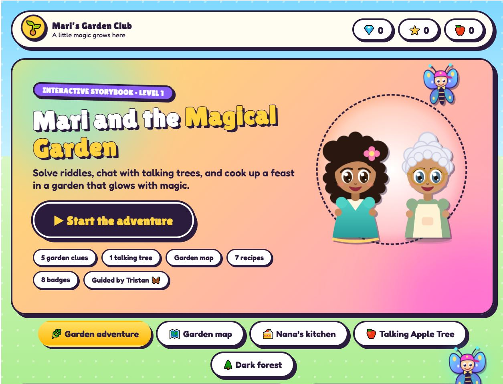

# Mari and the Magical Garden

An interactive cartoon storybook game for kids. Help Mari solve Nana's fruit riddles, chat with a talking apple tree, creep through a spooky forest, and bake a special tart pie.

**Play it online:** https://github.com/CoolBeans2016/Magic-Garden.git

## About

Nana has hidden her garden's magic in a set of riddles. Mari and her butterfly helper Tristan travel from the sunny orchard to the dark Whispering Forest to collect everything Nana needs for her special tart pie.

## How to play

1. **Start the adventure.** Read the storybook intro, then press the start button.
2. **Garden adventure.** Nana gives a riddle in each garden. Tap the fruit that matches the clue to earn gems and stars.
3. **Garden map.** Tap any spot to learn about it and jump to it.
4. **Talking Apple Tree.** Chat with Rosie and solve her riddles. Every right answer drops an apple into your basket.
5. **Dark forest.** Creep through two spooky levels. Make calm, careful choices, copy the owls' tune, and flash your lantern at the bats. Rash choices cost you a lantern light, and if all three go out you start the level again.
   - Level 1 finds the glowing **Moonberries**.
   - Level 2 finds the **Starlight Honey**.
6. **Nana's kitchen.** Gather the ingredients and bake recipes. The special tart pie needs 6 apples, Moonberries and Starlight Honey.
7. **Ask Tristan.** Tap the butterfly any time for a hint. He also warns Mari about danger.

Collect gems, stars, badges and diary entries along the way.

## Features

- 5 riddle rounds, a garden map, 7 recipes, and a talking apple tree with 16 riddles
- 2 spooky forest levels with different mini-games (choices, a memory game and a tapping challenge)
- Cartoon-style art drawn in SVG, with animations
- Spooky background music and sound effects made in the browser (Web Audio), with a mute button
- Badges and an adventure diary
- Progress is saved in the browser, with a "Start a new game" button
- Works on desktop and mobile

## Run it locally

No install needed. Download this repo and open `index.html` in a browser.

## Publish with GitHub Pages

1. Upload `index.html`, `README.md` and `screenshot.png` to a GitHub repo.
2. Go to **Settings → Pages**.
3. Under **Build and deployment**, choose **Deploy from a branch**, pick `main` and `/ (root)`, then save.
4. After a minute, your game is live at `https://YOUR-USERNAME.github.io/REPO-NAME/`.

## Built with

HTML, CSS and vanilla JavaScript in a single file, with no frameworks or build step. Fonts come from Google Fonts (Fredoka, Lilita One, Quicksand, Berkshire Swash).

Designed by me and built with help from Claude (Anthropic).
